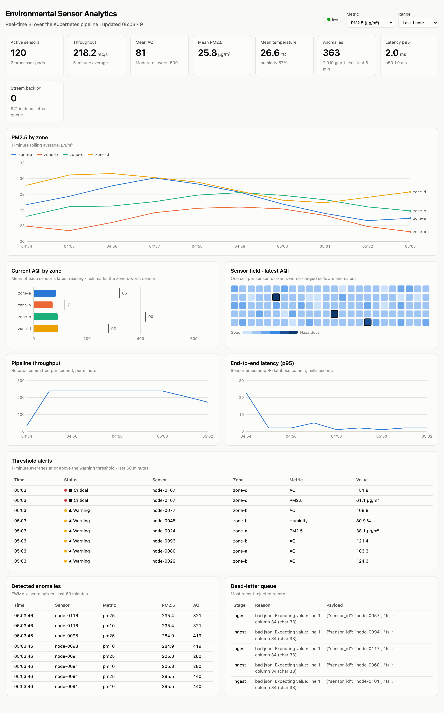
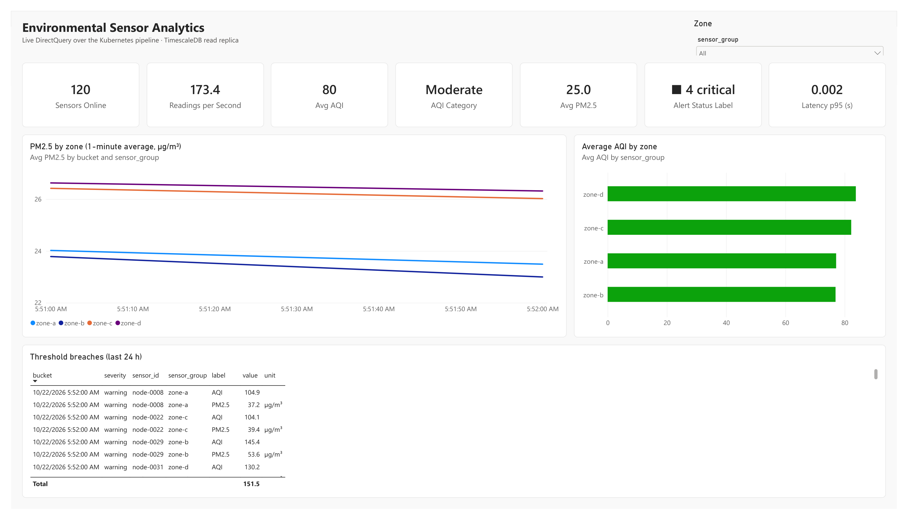
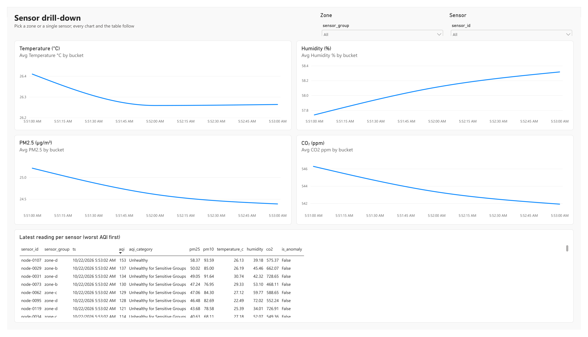
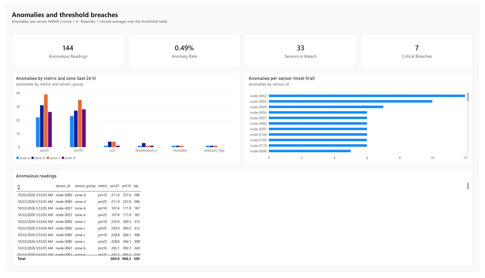
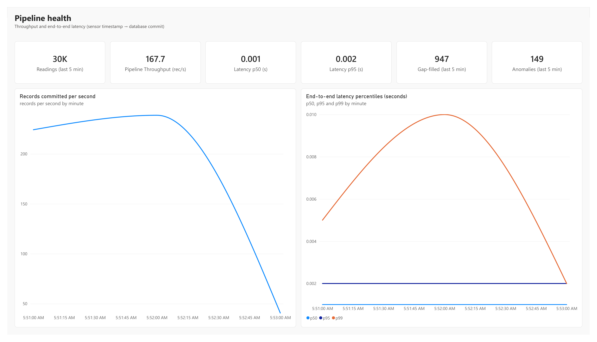

# A Kubernetes-Based Real-Time Business Intelligence Framework for Scalable Environmental Sensor Data Analytics

[](https://github.com/likhith-ts/VA-K8s-Sensor-BI/actions/workflows/ci.yml)


Visual Analytics semester project · Team 17 — Likhith Usurupati, Sai Chandra Kousthubh, Chilla Kalyan Sai Reddy



An end-to-end pipeline that takes environmental telemetry (temperature,
humidity, pressure, PM2.5, PM10, CO₂) from a simulated IoT sensor field,
validates and transforms it in containerised microservices orchestrated by
Kubernetes, stores it in TimescaleDB, and serves it to Power BI (DirectQuery
or push) and to a bundled live web dashboard.

```
Sensor field ──MQTT/HTTP──▶ ┌──────────────────── Kubernetes cluster ─────────────────────┐
 (sensor-sim)               │ Mosquitto ─▶ ingest ×3 ─▶ Redis Stream ─▶ process (HPA 2–10) │
                            │  (QoS 1)    (MQTT bridge,  (replayable     validate → DLQ     │
                            │              HTTP POST)    buffer, PEL)    normalise, gap-fill│
                            │                                            AQI, anomalies     │
                            │                                                 │             │
                            │                     TimescaleDB primary (tsdb-0) ◀┘           │
                            │                       1m / 15m / 1h continuous aggregates     │
                            │                       │ streaming replication                 │
                            │                     TimescaleDB replica (tsdb-1) ─▶ gateway ×2│
                            └──────────────────────────┬─────────────────────────┬─────────┘
                                                       │ DirectQuery (bi.*)      │ REST / SSE / push
                                                       ▼                         ▼
                                                    Power BI              Live web dashboard
```

## What maps to which objective

| Objective (review 1) | Implementation |
|---|---|
| 01 Real-time ingestion | [`services/ingest`](services/ingest/app.py): MQTT bridge on a shared subscription (`$share/ingest/sensors/#`, QoS 1) plus an HTTP `POST /ingest` endpoint. Batches writes into a Redis Stream; unparseable payloads go to the dead-letter stream. |
| 02 Containerised services | One [`Dockerfile`](Dockerfile) builds a separate image per service (`envbi/ingest`, `envbi/process`, `envbi/gateway`, `envbi/sensor-sim`), pinned dependencies, non-root user. |
| 03 Kubernetes orchestration | [`deploy/k8s`](deploy/k8s): Deployments with rolling updates and liveness/readiness probes, HPA on the processors (2–10 pods, CPU), optional KEDA scaler on stream backlog, ConfigMaps and Secrets, StatefulSets with PVCs for Redis and TimescaleDB. |
| 04 Time-series storage | [`db/init.sql`](db/init.sql): TimescaleDB hypertable, compression after 1 day, 30-day retention, 1-minute / 15-minute / 1-hour continuous aggregates, a primary and a streaming read replica. |
| 05 Power BI analytics | [`docs/powerbi`](docs/powerbi/README.md): curated `bi.*` views for DirectQuery, `.pbids` connection files, DAX measures, report layout, push streaming dataset, plus the [live dashboard](services/gateway/static/index.html). |
| 06 Scalability evaluation | [`bench/run_bench.py`](bench/run_bench.py): load sweep and failure-recovery tests against the Kubernetes stack and the non-orchestrated Compose baseline; [`bench/report.py`](bench/report.py) produces the comparison. |

## Power BI report

Four DirectQuery pages over the `bi` views, built from
[`docs/powerbi`](docs/powerbi/README.md) (full export:
[PDF](docs/project-dashboard-export.pdf)).



| Sensor drill-down | Anomalies | Pipeline health |
|---|---|---|
|  |  |  |

## Data flow (slide 9)

| Stage | Where |
|---|---|
| MQTT broker, QoS-1 topics per sensor group | Mosquitto, topics `sensors/<zone>/<sensor>` |
| Stream buffer with replay window | Redis Stream `telemetry:raw` (≈500k entries, AOF on a PVC), consumer group `processors` |
| Validator: schema and range checks | [`pipeline.validate_and_normalise`](common/envbi_common/pipeline.py) |
| Dead-letter queue | Redis Stream `telemetry:dlq`, with the reason and stage for every rejected record |
| Transformer: unit normalisation, gap-fill, derived AQI | °F/K → °C, kPa/inHg/mmHg → hPa; forward-fill from the last good reading (≤5 min old); US EPA AQI (2024 PM2.5 breakpoints) |
| Anomaly flags | per-sensor, per-metric EWMA z-score (state in Redis, so workers stay stateless) |
| Aggregator: rolling 1m, 15m, 1h | TimescaleDB continuous aggregates with real-time aggregation |
| Serving API | [`services/gateway`](services/gateway/app.py), `bi.*` SQL views |

Fault tolerance: stream entries are acknowledged only after the database
commit; entries left pending by a crashed worker are claimed by a live one
(`XAUTOCLAIM`); duplicate QoS-1 deliveries are dropped by the
`(sensor_id, ts)` primary key.

## Run it

> **Giving a live demo?** See [docs/DEMO.md](docs/DEMO.md): one command starts everything with an hour of history restored, plus a demo script and talking points.

Requirements: Docker Desktop with Kubernetes enabled (or any cluster that can
see locally built images), Python 3.11+.

### Option A: Kubernetes

```bash
./deploy/k8s/deploy.sh
```

This builds the four images, installs metrics-server if missing, applies the
manifests and waits for rollout. Then:

- Dashboard: http://localhost:8000 · API docs: http://localhost:8000/docs
- Feed it from the host:

```bash
python3 -m venv .venv && .venv/bin/pip install -r bench/requirements.txt
```

```bash
.venv/bin/python services/sensor-sim/sim.py --sensors 200 --rate 2
```

- Or in-cluster: `kubectl apply -f deploy/k8s/optional/load-generator.yaml`
- Watch scaling: `kubectl -n envbi get hpa,pods -w`
- Remove everything: `./deploy/k8s/teardown.sh`

Ports used on localhost: 1883 (MQTT), 8080 (ingest HTTP), 8000 (gateway),
5433 (TimescaleDB read replica for Power BI).

### Option B: Docker Compose (single host / baseline)

```bash
docker compose -f deploy/compose/docker-compose.yml up -d --build
```

Same ports, except TimescaleDB is on 5442. Stop it before deploying to
Kubernetes, since both publish 1883/8000/8080.

### Tests

```bash
PYTHONPATH=common .venv/bin/python -m pytest tests
```

(`.venv/bin/pip install pytest` first.)

## Scalability evaluation

```bash
.venv/bin/python bench/run_bench.py --target compose --scenario load
.venv/bin/python bench/run_bench.py --target compose --scenario recovery
# switch stacks, then
.venv/bin/python bench/run_bench.py --target k8s --scenario load
.venv/bin/python bench/run_bench.py --target k8s --scenario recovery
.venv/bin/python bench/report.py
```

Results and charts land in [`bench/results`](bench/results/REPORT.md).

### Results (single-node Docker Desktop, 10 vCPU)

| | Compose baseline | Kubernetes + HPA |
|---|---|---|
| Delivery, 200–3,000 msg/s | 100% at every step | 100% at every step |
| p95 latency at 3,000 msg/s | 11.8 ms | 6.1 ms |
| p99 latency at 3,000 msg/s | 48.3 ms | 16.4 ms |
| Worker pods at 3,000 msg/s | 1 (fixed) | 8 (HPA, from 2) |
| All workers killed at 1,000 msg/s | never recovers by itself; 80k backlog | recovers in ~1 s; peak backlog 6 |
| Readings lost in that failure | 0 (after a manual restart) | 0 |

The first Kubernetes run also exposed a deadlock between scaled-out workers
that silently stopped consumption; the cause and fix are written up in the
[report](bench/results/REPORT.md#finding-worker-deadlock-under-horizontal-scaling).

## Reusing it elsewhere

The services only read environment variables, so the same images run on any
container platform.

- **Any Kubernetes (kind, minikube, k3s, EKS, GKE, AKS):** push the images to
  a registry and point the manifests at them without editing them:

  ```bash
  for s in ingest process gateway sensor-sim; do
    docker build --build-arg SERVICE=$s -t ghcr.io/<you>/envbi-$s:1.0 . && docker push ghcr.io/<you>/envbi-$s:1.0
  done
  cd deploy/k8s && kustomize edit set image envbi/ingest=ghcr.io/<you>/envbi-ingest:1.0  # repeat per image
  ```

  On cloud clusters the `LoadBalancer` services get public addresses; switch
  them to `ClusterIP` plus an Ingress if you do not want MQTT or the database
  exposed.
- **Real sensors:** anything that can publish JSON over MQTT to
  `sensors/<zone>/<sensor_id>` (ESP32, Raspberry Pi, Node-RED) works in place
  of the simulator; the payload format is the one in
  [`sim.py`](services/sensor-sim/sim.py). Units are normalised on arrival.
- **Managed services:** `REDIS_URL` and `DATABASE_URL` can point at a managed
  Redis and Timescale Cloud / PostgreSQL with the TimescaleDB extension; run
  [`db/init.sql`](db/init.sql) once against it.
- **Other BI tools:** the `bi.*` views are plain PostgreSQL, so Tableau,
  Grafana, Superset or Metabase connect the same way Power BI does.

> **Credentials.** The passwords in `deploy/` (`envbi`, `replicator`,
> `powerbi`) are local-demo defaults. Change them in
> [`01-config.yaml`](deploy/k8s/01-config.yaml) and `db/init.sql`, or manage
> them with a secret store, before deploying anywhere reachable.

## Repository layout

```
common/envbi_common/   shared config, validation/transform/anomaly logic, AQI
services/sensor-sim/   IoT fleet simulator (MQTT or HTTP)
services/ingest/       MQTT bridge + HTTP ingestion → Redis Stream
services/process/      stream consumer: validate, transform, persist
services/gateway/      REST/SSE API, Power BI push, live dashboard
db/init.sql            TimescaleDB schema, aggregates, bi.* views
deploy/compose/        Docker Compose stack (baseline)
deploy/k8s/            Kubernetes manifests and scripts (+ optional KEDA, Prometheus)
docs/powerbi/          Power BI connection files, DAX measures, report guide
bench/                 benchmark harness and report generator
tests/                 unit tests for the pipeline logic
.github/workflows/     CI: tests, manifest render, image builds
```
