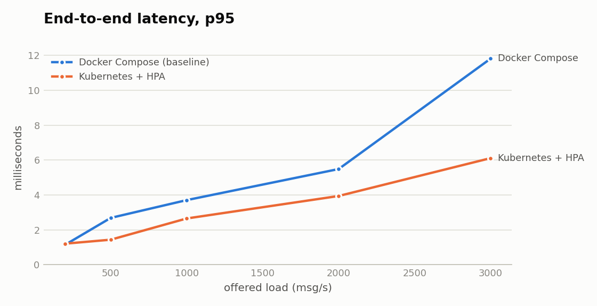
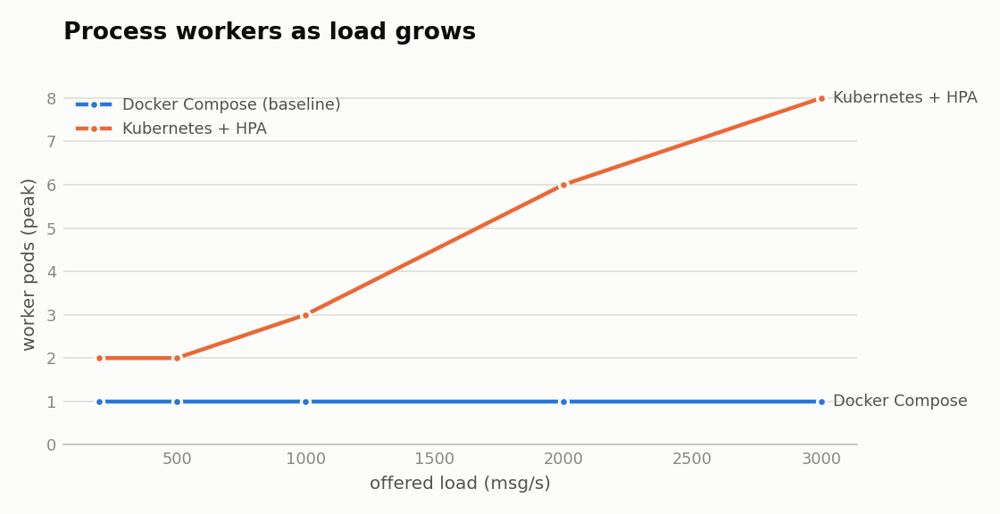
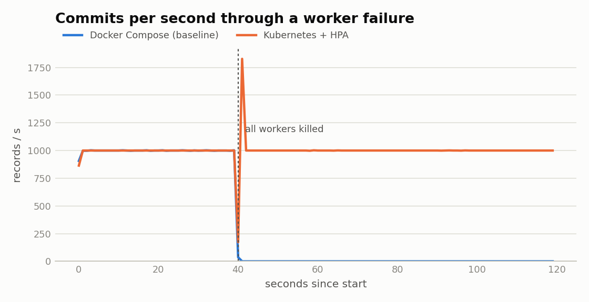

# Scalability evaluation

## Load sweep

| Stack | Offered (msg/s) | Achieved (msg/s) | Delivered | p50 latency (ms) | p95 (ms) | p99 (ms) | Peak backlog | Worker pods |
|---|---:|---:|---:|---:|---:|---:|---:|---:|
| Docker Compose (baseline) | 200 | 200 | 100.0% | 0.5 | 1.1 | 1.3 | 1 | 1 |
| Docker Compose (baseline) | 500 | 500 | 100.0% | 1.2 | 2.7 | 3.4 | 2 | 1 |
| Docker Compose (baseline) | 1,000 | 1,000 | 100.0% | 2.4 | 3.7 | 5.5 | 8 | 1 |
| Docker Compose (baseline) | 2,000 | 2,000 | 100.0% | 3.2 | 5.5 | 7.2 | 18 | 1 |
| Docker Compose (baseline) | 3,000 | 3,000 | 100.0% | 6.9 | 11.8 | 48.3 | 47 | 1 |
| Kubernetes + HPA | 200 | 200 | 100.0% | 0.9 | 1.2 | 1.5 | 1 | 2 |
| Kubernetes + HPA | 500 | 500 | 100.0% | 1.1 | 1.4 | 1.7 | 2 | 2 |
| Kubernetes + HPA | 1,000 | 1,000 | 100.0% | 1.4 | 2.7 | 3.8 | 6 | 3 |
| Kubernetes + HPA | 2,000 | 2,000 | 100.0% | 1.9 | 3.9 | 6.8 | 24 | 6 |
| Kubernetes + HPA | 3,000 | 3,000 | 100.0% | 2.0 | 6.1 | 16.4 | 98 | 8 |

Both stacks committed every message they were sent at every step (achieved throughput = offered load), so the comparison is in latency, backlog and how the capacity is provided.

## Failure recovery

Every process worker is killed part-way through a steady load.

| Stack | Load (msg/s) | Recovered by itself | Recovery time (s) | Peak backlog | Readings lost |
|---|---:|---|---:|---:|---:|
| Docker Compose (baseline) | 1,000 | no | – | 80,060 | 0 |
| Kubernetes + HPA | 1,000 | yes | 1.0 | 6 | 0 |

The baseline has no orchestrator, so nothing restarts the worker; the benchmark restarts it by hand afterwards only to confirm the backlog drains without loss. Under Kubernetes the Deployment controller replaces the pods and unacknowledged stream entries are claimed by the new workers.

## Test setup

- Both stacks ran on one MacBook under Docker Desktop (Linux VM: 10 vCPU, 8 GB), so the Kubernetes cluster is a single node; the comparison isolates orchestration behaviour, not extra hardware.
- Load came from `services/sensor-sim` processes on the host publishing over MQTT QoS 1 (400 sensors, ≤800 msg/s per simulator process), with missing fields and spikes enabled and malformed records disabled so every sent message should be stored.
- Latency is sensor timestamp → database commit, read from the stored rows; backlog is Redis stream lag + pending entries sampled every 2 s.
- Recovery kills every worker with SIGKILL semantics (`docker kill` / `kubectl delete --grace-period=0 --force`).

## Finding: worker deadlock under horizontal scaling

The first Kubernetes run exposed a bug the single-worker baseline could never hit. With the HPA at 10 pods, workers upserted overlapping rows of the `sensors` table in different orders inside the readings transaction; PostgreSQL detected 8 deadlocks within 2 s, and because the exception escaped the consume task silently, every worker stopped reading while its pod still looked healthy. Only the 15-second claim loops kept data moving, so p99 latency at 3,000 msg/s reached 32.8 s.

Fixes in `services/process/worker.py`: the sensor upsert moved to its own short transaction, locks rows in sorted order, and runs at most every 10 s per sensor per worker; transient database/Redis errors are retried per batch; and if a worker loop ever dies the process exits so Kubernetes restarts it. The CPU request was raised from 200m to 500m so the HPA scales with real load (it had reached 10 pods at 1,000 msg/s). After the fix p99 at 3,000 msg/s is 16 ms. All figures above are from the fixed code, for both stacks.
